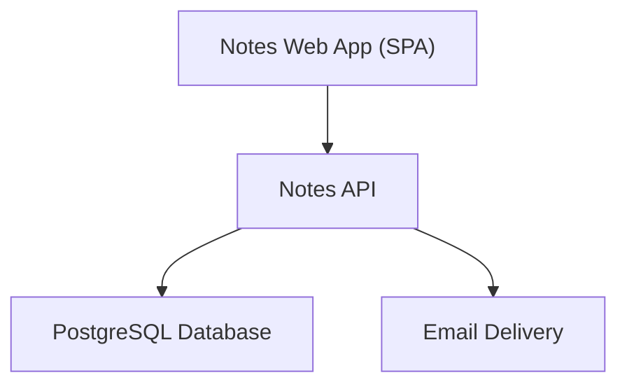
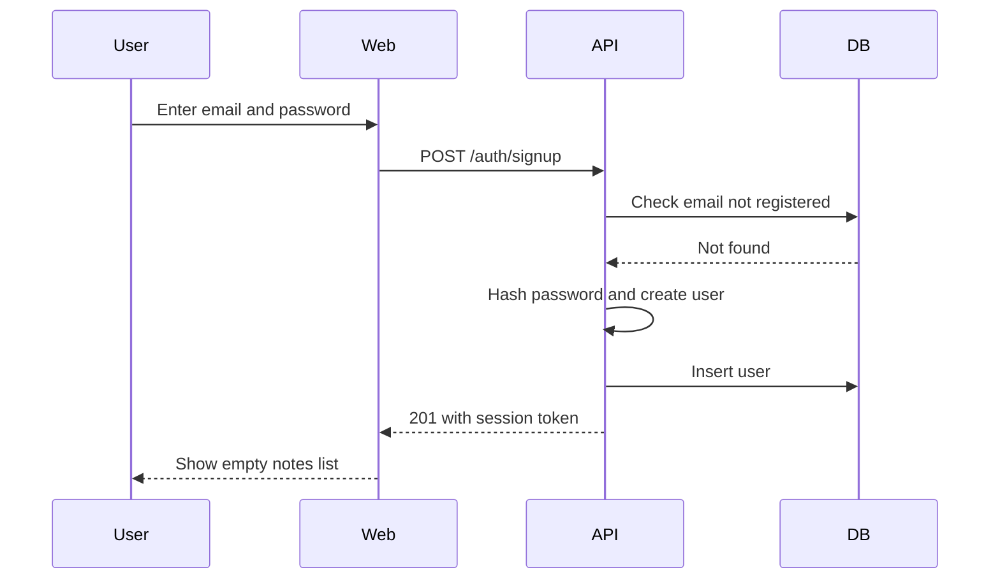
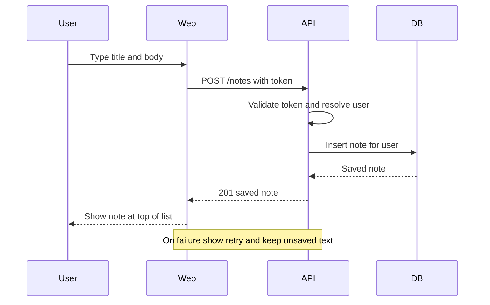
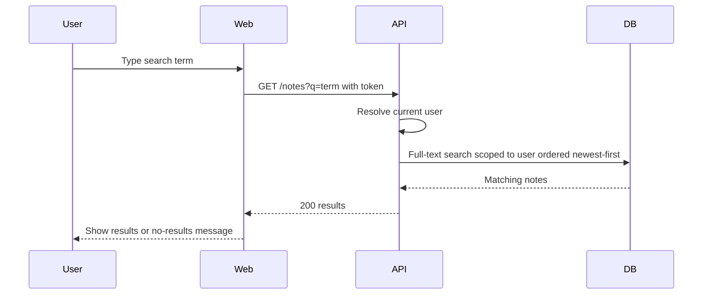
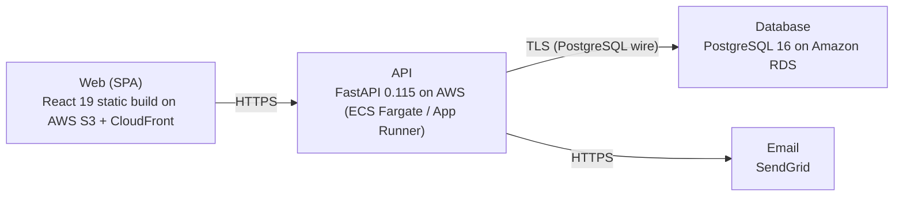

# Architecture

> Maintained by QuorQ AI SDLC. Text between `sdlc:auto` markers is regenerated; anything outside them is yours and is kept.

<!-- sdlc:auto:start narrative -->
## Overview

### ARCH-000 · draft

No architecture/design phase input has been provided for this project yet.

No screens, data models, API contracts, infrastructure design, or technical decisions beyond the product-owner-approved stack (FastAPI, AWS, PostgreSQL 16, React 19) and SendGrid service have been supplied. The architecture phase has not started or its output has not been captured here.

- ⚠ Architecture phase has not started: no screen designs, API contracts, data model, or infrastructure/deployment design available.
- ⚠ Open assumptions from requirements that design should resolve: exact password rules, whether sign-up sends a verification email, and whether note saving is auto-save or explicit-save.
<!-- sdlc:auto:end narrative -->

<!-- sdlc:auto:start building-blocks -->
## Building Block View

| ID | Name | Technology | Responsibility | Depends on |
|---|---|---|---|---|
| web | Notes Web App (SPA) | React 19 | Responsive UI for sign-up, sign-in, sign-out, notes list, note editor, and text search; adapts to desktop and mobile; handles auto-save and save-failure messaging. | api |
| api | Notes API | FastAPI 0.115 | REST API for authentication (sign-up, sign-in, sign-out) and note CRUD and search; issues/validates session tokens, hashes passwords, enforces per-user data isolation, triggers account emails. | db, email |
| db | PostgreSQL Database | PostgreSQL 16 | Stores users and notes; enforces relational integrity and provides built-in full-text search over note title and body. | — |
| email | Email Delivery | SendGrid | Sends transactional account emails (e.g. password reset) reliably to users' inboxes. | — |

<!-- sdlc:auto:end building-blocks -->

<!-- sdlc:auto:start runtime -->
## Runtime View

### Sign up and sign in

New visitor registers with email + password (validated, unique email, password rules, one-way hash). On success a session token is issued and the user lands on an empty notes list. Returning users authenticate; failures return a generic message that does not reveal whether the email exists.

- **Components:** web, api, db
- **Modules:** auth_router, auth_service, password_hasher, token_service, user_repository
- **Key functions:** sign_up(email, password), sign_in(email, password), hash_password(password), verify_password(password, hash), issue_token(user_id)

### Create and save a note

Signed-in user creates or edits a plain-text note; save persists to their account and the note appears at the top of the newest-first list. On save failure the user is told and unsaved text stays on screen.

- **Components:** web, api, db
- **Modules:** notes_router, notes_service, notes_repository, auth_dependency
- **Key functions:** create_note(user_id, title, body), update_note(user_id, note_id, title, body), require_current_user(token)

### List and search own notes

User retrieves their notes newest-first, or filters by a search term matched against title and body using PostgreSQL full-text search; empty and no-results states are handled. Queries are always scoped to the current user.

- **Components:** web, api, db
- **Modules:** notes_router, notes_service, notes_repository, search_query
- **Key functions:** list_notes(user_id), search_notes(user_id, query)

<!-- sdlc:auto:end runtime -->

<!-- sdlc:auto:start deployment-view -->
## Deployment View

| Name | Service | Runtime | Scaling | Environment |
|---|---|---|---|---|
| Web (SPA) | React 19 static build on AWS S3 + CloudFront | Static assets over HTTPS | CDN edge caching | dev |
| API | FastAPI 0.115 on AWS (ECS Fargate / App Runner) | Python 3.12 container behind HTTPS | 1 small instance for dev, horizontal if needed | dev |
| Database | PostgreSQL 16 on Amazon RDS | Managed PostgreSQL 16 | Single small instance for dev | dev |
| Email | SendGrid | SaaS HTTPS API | Managed by provider | dev |

| Source | Target | Protocol |
|---|---|---|
| Web (SPA) | API | HTTPS |
| API | Database | TLS (PostgreSQL wire) |
| API | Email | HTTPS |

<!-- sdlc:auto:end deployment-view -->

<!-- sdlc:auto:start decisions -->
## Architecture Decisions

| Layer | Choice | ADR |
|---|---|---|
| Frontend | React 19 | [ADR-0001](adr/frontend.md) |
| Backend | FastAPI 0.115 | [ADR-0002](adr/backend.md) |
| Database | PostgreSQL 16 | [ADR-0003](adr/database.md) |
| Cloud | AWS | [ADR-0004](adr/cloud.md) |
<!-- sdlc:auto:end decisions -->

<!-- sdlc:auto:start links -->
## Related Documents

- [Data Model](data-model.md)
- [API Specification](api/openapi.yaml)
- [Architecture Decision Records](adr/README.md)
<!-- sdlc:auto:end links -->
