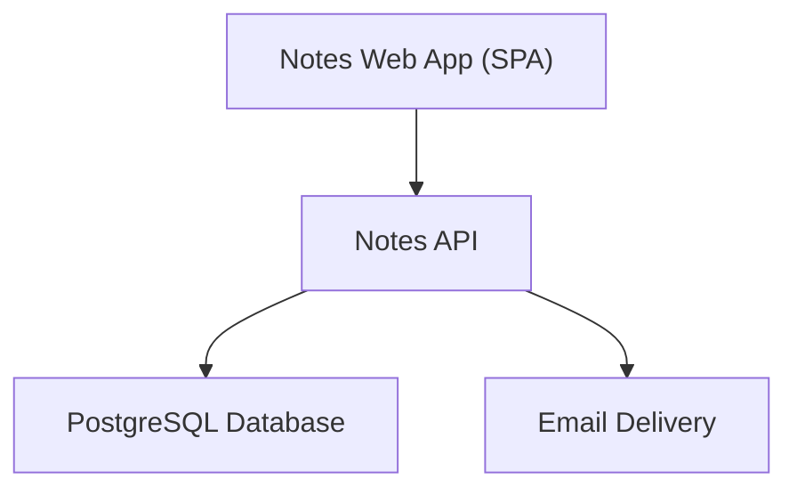
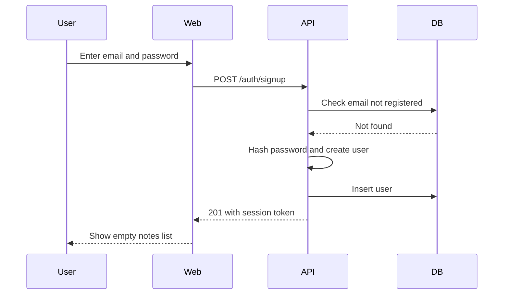
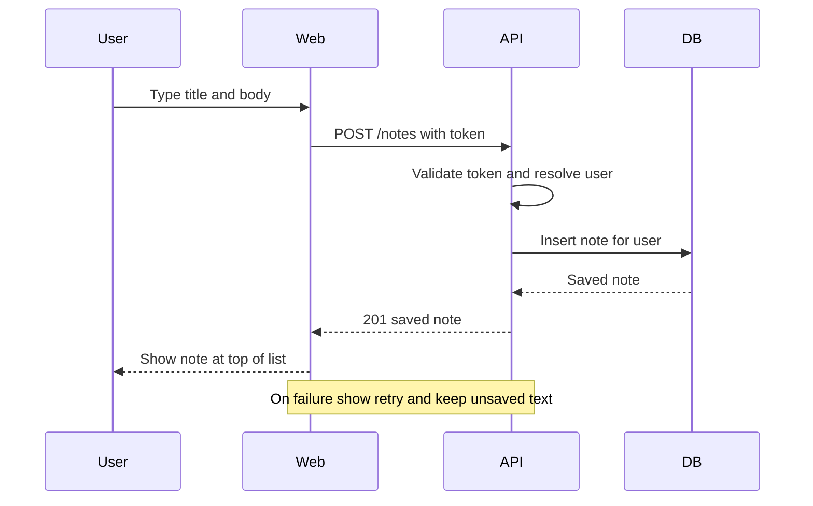
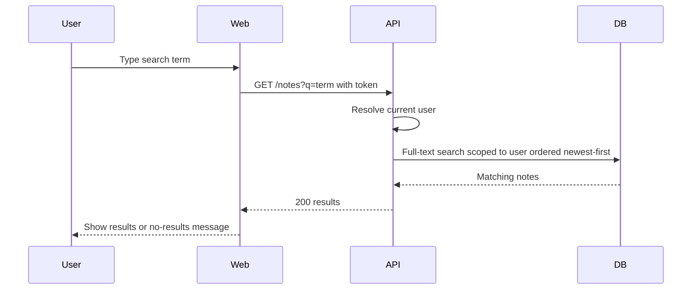
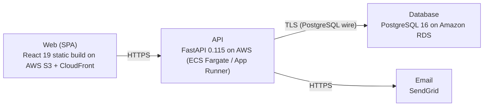

# Architecture

> Maintained by QuorQ AI SDLC. Text between `sdlc:auto` markers is regenerated; anything outside them is yours and is kept.

<!-- sdlc:auto:start narrative -->
## Overview

### ARCH-overview · approved · source: architecture:summary

Approved architecture (v1) for a lightweight personal notes web app: React 19 SPA + FastAPI 0.115 API + PostgreSQL 16, hosted on AWS, with SendGrid for account emails.

System is a single-user-scoped notes app. Users sign up/sign in with email+password (one-way hashed, HTTPS-only). Each signed-in user can create/view/edit/delete their own plain-text notes, see them newest-first, and search title/body via PostgreSQL's built-in full-text search (no separate search service). Per-user isolation is enforced on every note query and endpoint. Explicitly out of scope: billing, folders, tags, attachments, rich text.

- ⚠ No explicit mapping given from this architecture to specific requirement IDs (US-001..US-014); traceability between requirements and architecture elements could not be confirmed and should be verified by a human.

### ARCH-COMP-web · approved · source: architecture:components:web

Notes Web App is a React 19 single-page application providing the full user-facing UI.

Responsive UI (desktop and mobile) for sign-up, sign-in, sign-out, the notes list, the note editor, and text search. Handles auto-save of notes and displays save-failure messaging when a save does not succeed.

**Related:** ARCH-overview

### ARCH-COMP-api · approved · source: architecture:components:api

Notes API is a FastAPI 0.115 REST backend handling authentication and note CRUD/search.

Provides sign-up, sign-in, sign-out; issues and validates session tokens; hashes passwords one-way; enforces per-user data isolation on all note operations; triggers transactional account emails (e.g. password reset) via the email component.

**Related:** ARCH-overview

### ARCH-COMP-db · approved · source: architecture:components:db

PostgreSQL 16 is the single data store for users and notes.

Stores users and notes tables, enforces relational integrity, and provides built-in full-text search (tsvector + GIN) over note title and body -- chosen specifically so no separate search service is needed.

**Related:** ARCH-overview

### ARCH-COMP-email · approved · source: architecture:components:email

SendGrid delivers transactional account emails such as password reset messages.

Used by the API to reliably send account-related emails (e.g. password reset) to users' inboxes; a SaaS HTTPS API, not self-hosted.

**Related:** ARCH-overview

### ARCH-PATH-signup-signin · approved · source: architecture:critical_paths:Sign up and sign in

Defines the sign-up and sign-in flow, including validation and generic failure messaging.

New visitor registers with email + password (unique email required, password rules enforced, password one-way hashed). On success a session token is issued and the user lands on an empty notes list. Returning users authenticate via sign-in; authentication failures return a generic message that does not reveal whether the email exists, to avoid account enumeration.

**Related:** ARCH-COMP-api, ARCH-COMP-db

### ARCH-PATH-create-save-note · approved · source: architecture:critical_paths:Create and save a note

Defines the note creation/editing and save flow, including save-failure handling.

Signed-in user creates or edits a plain-text note. On save, the note persists to the user's account and appears at the top of the newest-first list. If save fails, the user is told and their unsaved text remains on screen (not lost).

**Related:** ARCH-COMP-web, ARCH-COMP-api, ARCH-COMP-db

### ARCH-PATH-list-search-notes · approved · source: architecture:critical_paths:List and search own notes

Defines retrieval and search of a user's own notes, always scoped per-user.

User retrieves notes newest-first, or filters by a search term matched against title and body using PostgreSQL full-text search. Empty-list and no-results states are handled explicitly. All queries are scoped to the currently signed-in user only.

**Related:** ARCH-COMP-web, ARCH-COMP-api, ARCH-COMP-db

### ARCH-DATA-entities · approved · source: architecture:entities

Two entities: users and notes, with notes holding a precomputed search vector.

users: id, email, password_hash, created_at. notes: id, user_id, title, body, search_tsv, created_at, updated_at. search_tsv backs the PostgreSQL full-text search feature; updated_at drives newest-first ordering when a note is edited.

**Related:** ARCH-COMP-db

### ARCH-API-surface · approved · source: architecture:endpoints

Defined REST surface for authentication, password reset, and note CRUD/search.

Auth: POST /auth/signup (rejects duplicate email/invalid input, signs user in on success); POST /auth/signin (generic error, does not reveal email existence); POST /auth/signout (ends session); POST /auth/password-reset (sends reset email via SendGrid, always returns success to avoid revealing account existence). Notes: GET /notes (current user's notes newest-first, optional q= full-text filter over title+body); POST /notes (create plain-text note for current user); GET /notes/{id} (get one of current user's notes, denies access to others' notes); PUT /notes/{id} (update title/body, bumps updated_at); DELETE /notes/{id} (delete current user's note).

**Related:** ARCH-COMP-api, ARCH-DATA-entities

### ARCH-DEPLOY-topology · approved · source: architecture:deployment_nodes

All components are deployed on AWS plus the SendGrid SaaS email API.

Web: React 19 static build on AWS S3 + CloudFront, served over HTTPS. API: FastAPI 0.115 on AWS (ECS Fargate / App Runner), Python 3.12 container behind HTTPS. Database: PostgreSQL 16 on Amazon RDS (managed). Email: SendGrid, accessed as a SaaS HTTPS API.

**Related:** ARCH-COMP-web, ARCH-COMP-api, ARCH-COMP-db, ARCH-COMP-email

- ⚠ Choice between ECS Fargate and App Runner for the API is left open ('ECS Fargate / App Runner') and not finalized in this input.

### ARCH-TECH-decisions · approved · source: architecture:technology_decisions

Four technology choices were made with stated alternatives and rationale.

Frontend: React 19 (vs Vue, Svelte) -- drives SPA note editing, auto-save, live search filtering, responsive layouts from one codebase. Backend: FastAPI 0.115 (vs Flask, Django REST Framework) -- hosts the scoped auth + note CRUD + search API with Pydantic validation and automatic OpenAPI docs. Database: PostgreSQL 16 (vs MySQL, SQLite) -- relational storage for users/notes plus built-in full-text search (tsvector + GIN), keeping to a single data store. Cloud: AWS (vs Google Cloud, Azure) -- hosts SPA (S3/CloudFront), API container, and managed Postgres (RDS) from one low-cost, scalable account.

**Related:** ARCH-overview
<!-- sdlc:auto:end narrative -->

<!-- sdlc:auto:start building-blocks -->
## Building Block View

| ID | Name | Technology | Responsibility | Depends on |
|---|---|---|---|---|
| web | Notes Web App (SPA) | React 19 | Responsive UI for sign-up, sign-in, sign-out, notes list, note editor, and text search; adapts to desktop and mobile; handles auto-save and save-failure messaging. | api |
| api | Notes API | FastAPI 0.115 | REST API for authentication (sign-up, sign-in, sign-out) and note CRUD and search; issues/validates session tokens, hashes passwords, enforces per-user data isolation, triggers account emails. | db, email |
| db | PostgreSQL Database | PostgreSQL 16 | Stores users and notes; enforces relational integrity and provides built-in full-text search over note title and body. | — |
| email | Email Delivery | SendGrid | Sends transactional account emails (e.g. password reset) reliably to users' inboxes. | — |

<!-- sdlc:auto:end building-blocks -->

<!-- sdlc:auto:start runtime -->
## Runtime View

### Sign up and sign in

New visitor registers with email + password (validated, unique email, password rules, one-way hash). On success a session token is issued and the user lands on an empty notes list. Returning users authenticate; failures return a generic message that does not reveal whether the email exists.

- **Components:** web, api, db
- **Modules:** auth_router, auth_service, password_hasher, token_service, user_repository
- **Key functions:** sign_up(email, password), sign_in(email, password), hash_password(password), verify_password(password, hash), issue_token(user_id)

### Create and save a note

Signed-in user creates or edits a plain-text note; save persists to their account and the note appears at the top of the newest-first list. On save failure the user is told and unsaved text stays on screen.

- **Components:** web, api, db
- **Modules:** notes_router, notes_service, notes_repository, auth_dependency
- **Key functions:** create_note(user_id, title, body), update_note(user_id, note_id, title, body), require_current_user(token)

### List and search own notes

User retrieves their notes newest-first, or filters by a search term matched against title and body using PostgreSQL full-text search; empty and no-results states are handled. Queries are always scoped to the current user.

- **Components:** web, api, db
- **Modules:** notes_router, notes_service, notes_repository, search_query
- **Key functions:** list_notes(user_id), search_notes(user_id, query)

<!-- sdlc:auto:end runtime -->

<!-- sdlc:auto:start deployment-view -->
## Deployment View

| Name | Service | Runtime | Scaling | Environment |
|---|---|---|---|---|
| Web (SPA) | React 19 static build on AWS S3 + CloudFront | Static assets over HTTPS | CDN edge caching | dev |
| API | FastAPI 0.115 on AWS (ECS Fargate / App Runner) | Python 3.12 container behind HTTPS | 1 small instance for dev, horizontal if needed | dev |
| Database | PostgreSQL 16 on Amazon RDS | Managed PostgreSQL 16 | Single small instance for dev | dev |
| Email | SendGrid | SaaS HTTPS API | Managed by provider | dev |

| Source | Target | Protocol |
|---|---|---|
| Web (SPA) | API | HTTPS |
| API | Database | TLS (PostgreSQL wire) |
| API | Email | HTTPS |

<!-- sdlc:auto:end deployment-view -->

<!-- sdlc:auto:start decisions -->
## Architecture Decisions

| Layer | Choice | ADR |
|---|---|---|
| Frontend | React 19 | [ADR-0001](adr/frontend.md) |
| Backend | FastAPI 0.115 | [ADR-0002](adr/backend.md) |
| Database | PostgreSQL 16 | [ADR-0003](adr/database.md) |
| Cloud | AWS | [ADR-0004](adr/cloud.md) |
<!-- sdlc:auto:end decisions -->

<!-- sdlc:auto:start links -->
## Related Documents

- [Data Model](data-model.md)
- [API Specification](api/openapi.yaml)
- [Architecture Decision Records](adr/README.md)
<!-- sdlc:auto:end links -->
