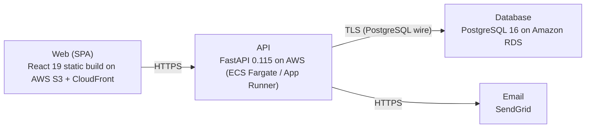

# Deployment Guide

> Maintained by QuorQ AI SDLC. Text between `sdlc:auto` markers is regenerated; anything outside them is yours and is kept.

<!-- sdlc:auto:start how-it-deploys -->
Pushes to `main` run `.github/workflows/deploy.yml`, which builds the API image (if there is a backend) and deploys the SPA to AWS Amplify. Commits touching only `docs/sdlc/**` don't deploy. Deployments can also be started from the platform's Deployment tab.
<!-- sdlc:auto:end how-it-deploys -->

<!-- sdlc:auto:start environments -->
| Name | Service | Runtime | Scaling | Environment |
|---|---|---|---|---|
| Web (SPA) | React 19 static build on AWS S3 + CloudFront | Static assets over HTTPS | CDN edge caching | dev |
| API | FastAPI 0.115 on AWS (ECS Fargate / App Runner) | Python 3.12 container behind HTTPS | 1 small instance for dev, horizontal if needed | dev |
| Database | PostgreSQL 16 on Amazon RDS | Managed PostgreSQL 16 | Single small instance for dev | dev |
| Email | SendGrid | SaaS HTTPS API | Managed by provider | dev |
<!-- sdlc:auto:end environments -->

<!-- sdlc:auto:start live -->
_Not deployed yet._
<!-- sdlc:auto:end live -->

<!-- sdlc:auto:start topology -->

<!-- sdlc:auto:end topology -->
